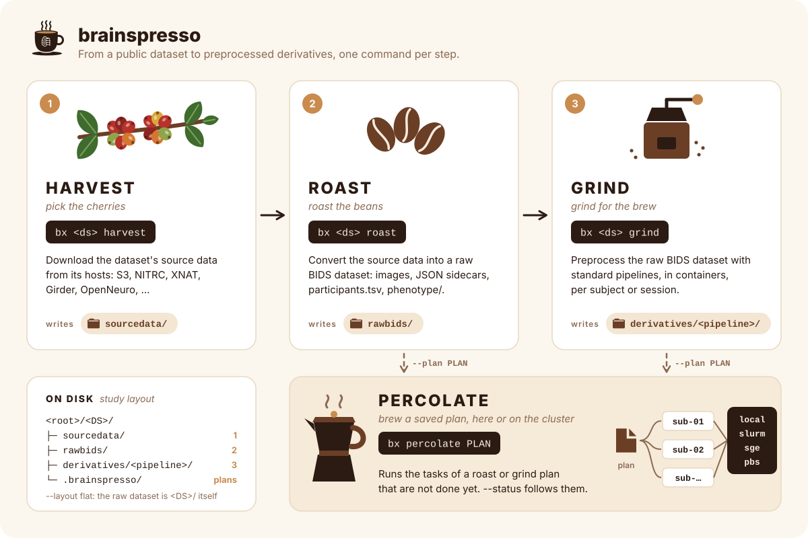

<h1 align="center">
  
</h1>

<p align="center">
  <a href="https://balbasty.github.io/brainspresso/"><b>Documentation</b></a> ·
  <a href="https://balbasty.github.io/brainspresso/getting-started/installation/">Installation</a> ·
  <a href="https://balbasty.github.io/brainspresso/origins/">Supported datasets</a>
</p>

brainspresso downloads public neuroimaging datasets and converts them to
[BIDS](https://bids.neuroimaging.io). Each supported dataset is a command of
the `bx` program, with the same subcommands for every dataset:
**harvest** (download), **roast** (convert to BIDS) and **compost** (clean
up). **Grind** (preprocessing) and **percolate** (running plans on a cluster)
are planned.



## Installation

```shell
pip install "brainspresso[all] @ git+https://github.com/balbasty/brainspresso"
```

## Examples

```shell
# List the supported datasets, and what one of them provides
bx --help
bx ixi info

# Download the T1w and T2w images of IXI, convert them to BIDS,
# then delete the archives
bx ixi harvest /data --keys T1w T2w meta
bx ixi roast /data
bx ixi compost /data

# Download part of a dataset that is already in BIDS
bx openneuro harvest ds000224 /data --subs MSC01 MSC02 --datatypes anat
bx hbn harvest /data --sites Site-RU --suffixes T1w --where "Age<10"
```

See the [documentation](https://balbasty.github.io/brainspresso/) for the
on-disk layout, the selection options, configuration files, and a description
of each dataset with its access requirements and references.

This is a work in progress, and command-line options may still change.

## Funding

This application is being developed as part of the project
_"High-resolution spatiotemporal models of the brain across the lifespan
for diagnosis and decision-making"_, funded by a fellowship of the
Royal Society (NIF\R1\232460).
