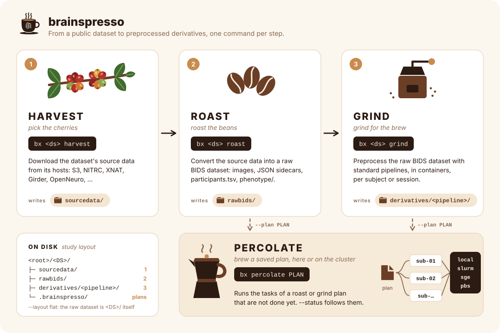

<h1 class="wordmark">
  
  
</h1>

brainspresso downloads public neuroimaging datasets and converts them to
[BIDS](https://bids.neuroimaging.io). Each supported dataset, or *origin*, is a
command of the `bx` program, and every origin has the same subcommands.

{ .diagram }

| Command   | What it does |
|-----------|--------------|
| `harvest` | Downloads the source data from the dataset's hosts into `sourcedata/`. |
| `roast`   | Converts the source data into a raw BIDS dataset. |
| `compost` | Deletes source data once it has been converted, or the BIDS data outside a filter. |
| `info`    | Lists the data categories (*keys*) and sources of a dataset. |
| `grind`   | Preprocesses the raw BIDS dataset with standard pipelines. *Planned.* |
| `percolate` | Runs a saved plan of roast or grind tasks, locally or on a cluster. *Planned.* |

Datasets that are already in BIDS on their host, such as OpenNeuro and most
INDI projects, are placed directly in the BIDS tree during the harvest. Their
metadata is still checked and repaired, and the tables are trimmed to the
files that were downloaded.

## Example

```shell
pip install "brainspresso[ixi] @ git+https://github.com/balbasty/brainspresso"

bx ixi harvest /data --keys T1w T2w meta    # download T1w and T2w images
bx ixi roast /data                          # convert them to BIDS
bx ixi compost /data                        # delete the archives
```

The result is a BIDS dataset in `/data/IXI/rawbids/`, with the original
archives in `/data/IXI/sourcedata/` until they are composted. A hosted dataset
can be filtered before anything is downloaded:

```shell
bx openneuro harvest ds000224 /data --sub MSC01 MSC02 --datatype anat
bx hbn harvest /data --site Site-RU --suffix T1w --where "Age<10"
```

## Where to go next

* [Installation](getting-started/installation.md) and
  [your first dataset](getting-started/first-dataset.md).
* The [user guide](guide/layout.md) describes the on-disk layout, the selection
  options, and each command in detail.
* [Origins](origins/index.md) lists every supported dataset: what the study is
  about, which modalities it contains, how to obtain access, and what to cite.

!!! warning "Work in progress"

    brainspresso is under active development. Command-line options may still
    change between versions.

## Funding

brainspresso is developed as part of the project *High-resolution
spatiotemporal models of the brain across the lifespan for diagnosis and
decision-making*, funded by a Royal Society fellowship (NIF\R1\232460).
